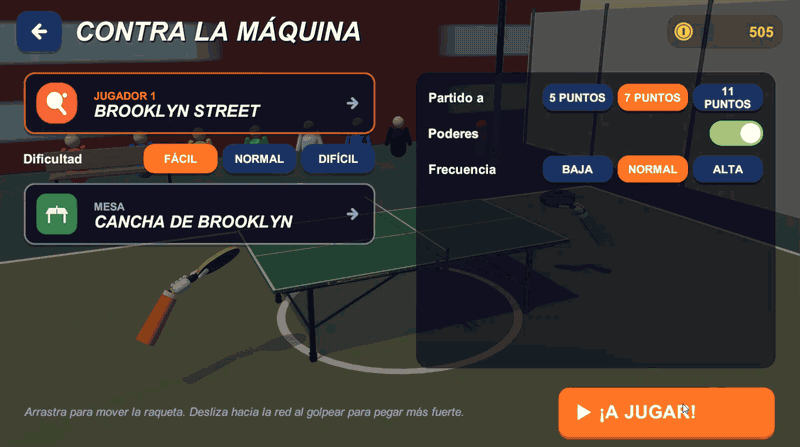
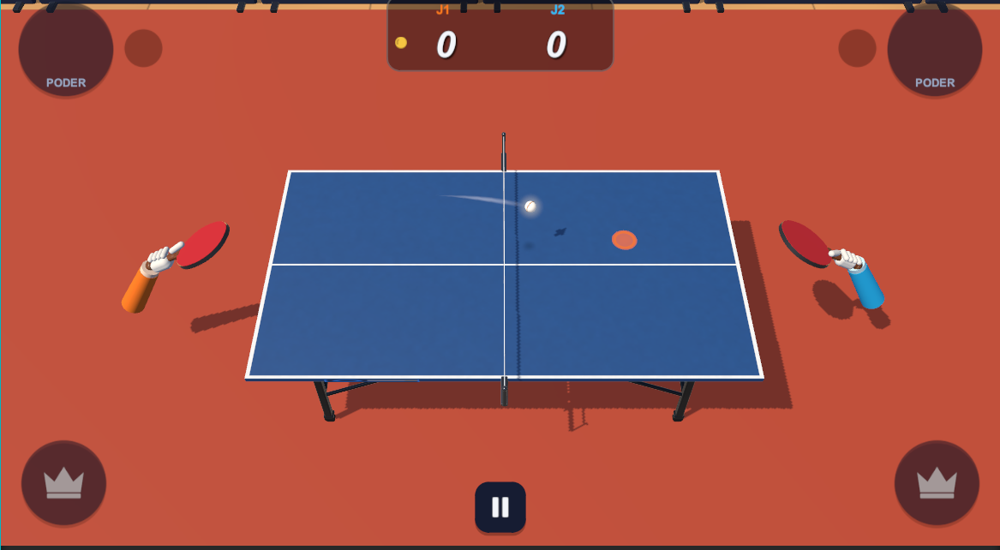
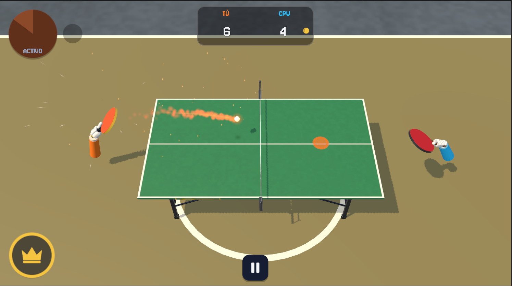
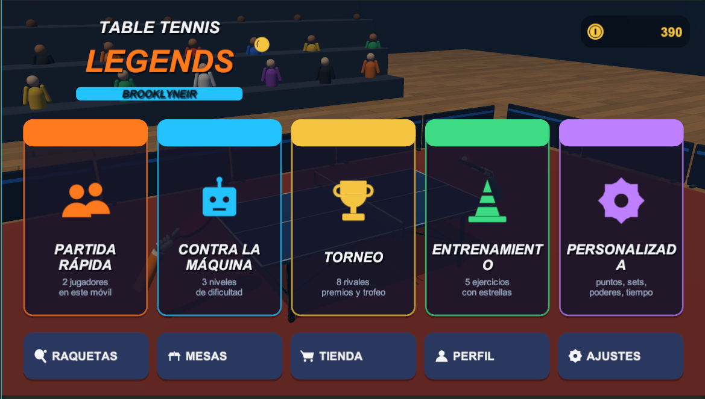
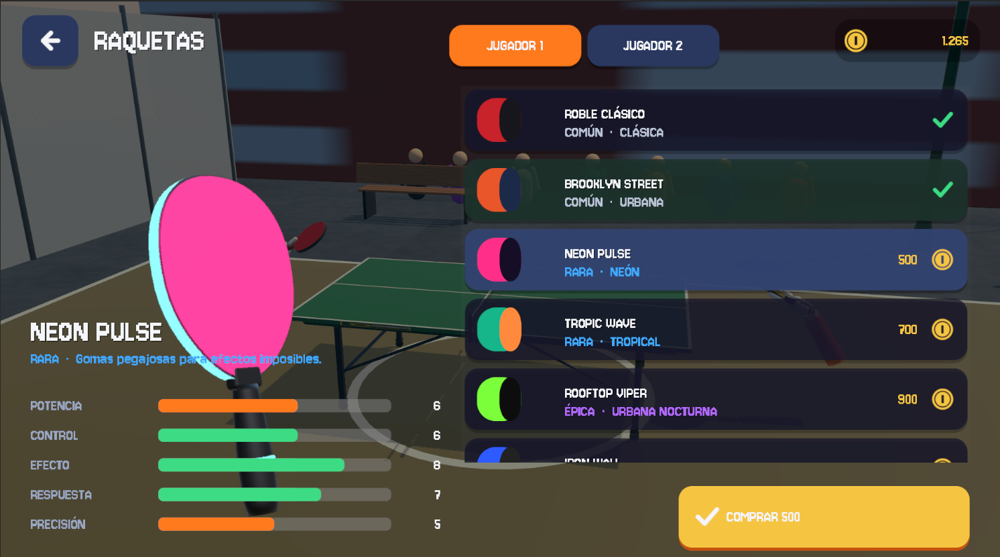
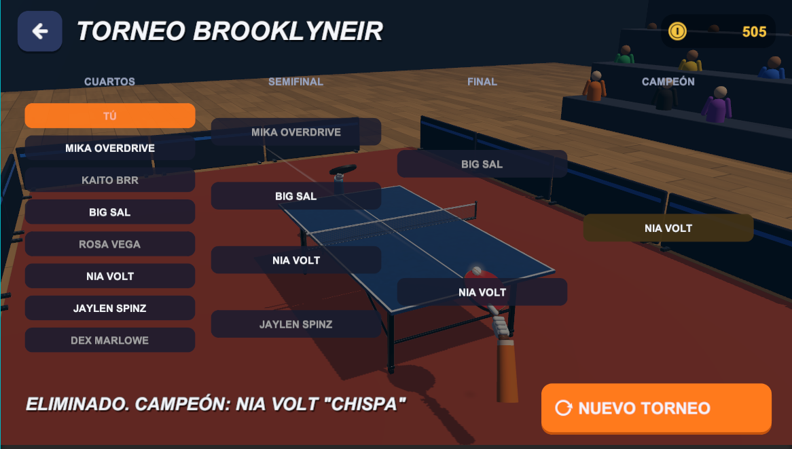
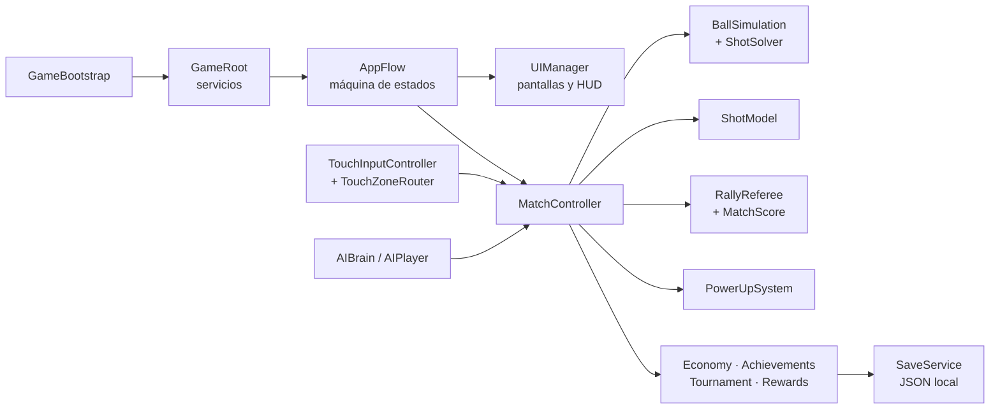

<div align="center">

# 🏓 Table Tennis Legends Brooklyneir

**Juego arcade de tenis de mesa en 3D para Android: dos jugadores en el mismo móvil, sin conexión.**


</div>

<p align="center">
  
</p>

<p align="center">
  
  
</p>
<p align="center">
  
  
  
</p>

---

## Índice

- [Sobre el proyecto](#sobre-el-proyecto)
- [Características](#características)
- [Aspectos técnicos destacados](#aspectos-técnicos-destacados)
- [Arquitectura](#arquitectura)
- [Tecnologías](#tecnologías)
- [Cómo ejecutarlo](#cómo-ejecutarlo)
- [Controles](#controles)
- [Pruebas](#pruebas)
- [Estructura del proyecto](#estructura-del-proyecto)
- [Estado y próximos pasos](#estado-y-próximos-pasos)
- [Créditos](#créditos)
- [Autor](#autor)

---

## Sobre el proyecto

Table Tennis Legends Brooklyneir es un juego de ping-pong arcade pensado para jugar **cara a cara en un solo teléfono en horizontal**: el jugador 1 controla la mitad izquierda de la pantalla y el jugador 2 la derecha, con multitáctil simultáneo. También se puede jugar contra la máquina, en torneo o en modo entrenamiento.

El objetivo técnico era construir un juego completo **casi sin assets externos**: los modelos 3D, las texturas, los iconos, los efectos y la interfaz se generan por código al arrancar, y los sonidos son originales. La única excepción es la tipografía, **Jersey 10**, que se incluye como archivo con su licencia libre (ver [Créditos](#créditos)).

| | |
|---|---|
| **Plataforma** | Android 8.0+ (ARM64, IL2CPP) |
| **Motor** | Unity 6.6 · Universal Render Pipeline |
| **Lenguaje** | C# |
| **Código** | ~13.900 líneas en 68 archivos + 109 pruebas automáticas |
| **Conexión** | No necesita Internet ni cuentas (sin anuncios ni pagos) |

---

## Características

**🎮 Modos de juego**
- **Partida rápida** a dos jugadores en el mismo móvil.
- **Contra la CPU** con tres dificultades (fácil, normal y difícil).
- **Torneo** de 8 jugadores con cuadro real: cuartos, semifinales y final.
- **Entrenamiento** con máquina lanzabolas: 5 ejercicios con puntuación por estrellas.
- **Pared de práctica**: saca y devuelve contra una pared sin límite, con racha y estadísticas de la sesión.
- **Partida personalizada**: puntos, sets, límite de tiempo, poderes y rival.

**⚡ Jugabilidad arcade**
- Golpes según el gesto: normal, rápido, remate, defensivo y con efecto.
- 7 poderes (fuego, ralentización, curva, súper remate, escudo, congelación y aleatorio), cada uno con duración, enfriamiento y contrapartida.
- Golpe especial que se carga durante el punto.

**🏆 Progresión**
- 8 raquetas con estadísticas que cambian el juego: potencia, control, efecto, respuesta y precisión.
- 6 mesas y escenarios desbloqueables.
- Monedas, tienda, 10 logros y perfil con estadísticas.
- Guardado local con copia de seguridad.

**📱 Pensado para móvil**
- Multitáctil con seguimiento por dedo.
- Adaptado a pantallas con notch.
- Pausa automática al salir de la app o recibir una llamada.
- Vibración opcional y tres perfiles gráficos con objetivo de 60 FPS.

---

## Aspectos técnicos destacados

### Física de la pelota propia
No usa el motor de física de Unity: una pelota de 3 cm a más de 10 m/s contra una red de 2 mm atravesaría objetos o rebotaría de forma irregular. En su lugar:
- La simulación avanza en **subpasos de 1/240 s**.
- En cada subpaso calcula **analíticamente el instante exacto de contacto** con la mesa, la red y el suelo, así que la pelota **no puede atravesar nada**.
- Incluye efecto lateral y liftado.
- Es **determinista**, y la IA y el indicador de bote reutilizan la misma simulación para predecir trayectorias.

### Golpes: intención del jugador + solución inversa
- El gesto del jugador decide el tipo de golpe, la dirección y el efecto.
- Un **resolvedor balístico inverso** calcula la velocidad exacta para que la pelota llegue al punto elegido salvando la red.
- El error es **ruido gaussiano acotado** según el riesgo del golpe y las estadísticas de la raqueta: hay margen de fallo, pero no es aleatorio.
- **El golpe es el propio movimiento de la pala.** La dirección con la que atraviesas la pelota decide el tipo de golpe y hacia dónde va: recto, en diagonal, de lado (efecto) o hacia atrás (globo). La velocidad decide la fuerza.
- **Detección de impacto por barrido:** la posición de la pala se interpola entre fotogramas durante los subpasos de la pelota, así que un golpe rápido que atraviesa la pelota siempre conecta.

### Multitáctil local
`TouchZoneRouter` asigna cada dedo a un jugador por su identificador, según la mitad de la pantalla donde empieza el toque:
- Cada jugador controla **un dedo a la vez**: un dedo extra no puede robar ni bloquear el control del rival.
- Un dedo **conserva su dueño** aunque cruce la mitad.
- Los toques sobre botones se reservan para la interfaz.

### Contenido 100 % procedural
- `MeshFactory` genera las mallas: cajas biseladas, esferas, cilindros, piezas torneadas y extrusiones.
- Con ellas se construyen la mesa (con grosor, líneas, red y patas), las raquetas (madera, gomas y mango), las manos, el público y los 6 escenarios.
- Se ha verificado automáticamente la **orientación de todos los triángulos**.

### Arranque sin dependencias de escena
- La escena está vacía: `GameBootstrap` construye todos los servicios por código.
- No hay prefabs ni referencias de escena que se puedan romper.
- El equilibrado del juego vive en un **JSON editable** (`balance.json`), que se valida al cargar.

### Interfaz pixel art con TextMeshPro
- Toda la interfaz usa la tipografía **Jersey 10** a través de un único proveedor (`UiFont`): se carga una sola vez y, si faltara el archivo, el juego sigue con una fuente de respaldo (la de TextMeshPro o una del sistema).
- Los textos solo usan **cuatro tamaños fijos (32, 64, 96 y 128)**, para que los píxeles de la fuente se vean nítidos. La ruta de la fuente, los tamaños y la sombra viven en `ui.json`.
- Los títulos llevan una **sombra pixelada de 2 px**, hecha con una copia del texto, porque las fuentes raster no admiten los contornos de TextMeshPro.
- El **logotipo se coloca con las métricas reales de la fuente** (altura de mayúscula), con la separación entre líneas configurable en `ui.json`: se ve compacto en la pantalla de título y en la esquina del menú.
- El HUD del partido actualiza marcador, reloj y estadísticas **sin crear memoria nueva en cada fotograma**.

### Herramientas de editor
- `ProjectSetup` configura el proyecto automáticamente: pipeline URP, materiales, escena, ajustes de Android e iconos adaptativos.
- `BuildTools` añade un menú para compilar la APK o exportar a Android Studio con un clic.

---

## Arquitectura



La lógica de juego (física, reglas, marcador, poderes, economía, torneo e IA) está en **clases C# puras, sin dependencias de `MonoBehaviour`**. Por eso se puede probar con pruebas unitarias sin abrir una escena.

---

## Tecnologías

| Área | Tecnología |
|---|---|
| Motor | Unity 6.6 (6000.6) |
| Render | Universal Render Pipeline 17 |
| Entrada | Input System + EnhancedTouch |
| Interfaz | uGUI + TextMeshPro, construida por código · tipografía Jersey 10 (pixel art) |
| Pruebas | Unity Test Framework (NUnit) |
| Compilación Android | IL2CPP · ARM64 · API mínima 26 |
| Audio | WAV originales generados con Python + síntesis de respaldo en C# |

---

## Cómo ejecutarlo

### Requisitos
- **Unity Hub** y **Unity 6.6** (6000.6.x).
- Módulo **Android Build Support** con OpenJDK y Android SDK & NDK Tools, si quieres compilar la APK.

### Pasos
1. Clona el repositorio:
   ```bash
   git clone https://github.com/josue21599/TableTennisLegendsBrooklyneir.git
   ```
2. En Unity Hub: **Add → Add project from disk** → selecciona la carpeta.
3. Al abrirlo, ejecuta **Brooklyneir → Configurar proyecto** (la primera vez se lanza solo).
4. Abre `Assets/Scenes/Main.unity` y pulsa **Play**.

### Generar la APK
Menú **Brooklyneir → Compilar APK de depuración**. El archivo se genera en `Builds/Android/`.

Guía completa de compilación, firma y exportación a Android Studio: **[BUILD_ANDROID.md](BUILD_ANDROID.md)**.

---

## Controles

| Acción | En el móvil | En el editor |
|---|---|---|
| Mover la raqueta | Arrastrar el dedo en tu mitad de la pantalla | Ratón (J1) · Flechas / WASD |
| Sacar | Tocar la pantalla | Espacio (J1) · Intro (J2) |
| Golpe recto / remate | Atravesar la pelota moviendo la pala recto hacia la red (remate si es rápido y la bola viene alta) | Arrastrar el ratón |
| Dirigir el golpe | Golpear en diagonal: la pelota va hacia ese lado | Arrastrar el ratón |
| Efecto | Golpear moviendo la pala hacia arriba o abajo de la pantalla | Arrastrar el ratón |
| Globo defensivo | Golpear moviendo la pala hacia atrás | Arrastrar el ratón |
| Poder / especial | Botones de tu borde de la pantalla | Clic en los botones |

---

## Pruebas

**109 pruebas automáticas** (NUnit, modo EditMode) sobre la lógica del juego:

| Área | Qué se comprueba |
|---|---|
| Física | Botes, red, cinta y que la pelota no atraviese la mesa ni a 25 m/s |
| Golpes | Precisión del resolvedor, clasificación por dirección del golpe, desvío lateral acotado y proporcional, determinismo |
| Reglas | Doble bote, bola fuera, red, empates, rotación de saque, sets, punto de oro |
| Poderes | Duraciones, enfriamientos, interacciones entre poderes, limpieza al final del punto |
| Progresión | Economía, guardado corrupto, torneo reproducible con semilla, logros |
| Entrada e IA | Dos dedos simultáneos, prioridad de la interfaz, tiempos de reacción de la IA |
| Interfaz | Los tamaños de texto caen siempre en los cuatro fijos, configuración inválida reparada, logotipo apilado sin solapes y centrado, fuente única con respaldo y todos los caracteres del juego (tildes, ñ, ¡ ¿) presentes en la fuente |
| Pared de práctica | Rebote con la velocidad esperada, sin atravesar la pared a 10–40 m/s, reglas de pérdida, racha, sesión sin fin, determinismo |
| Integración | 60 peloteos completos CPU contra CPU con todos los sistemas reales |

Para ejecutarlas: **Window → General → Test Runner → EditMode → Run All**.

Detalle de lo probado y lista de pruebas manuales en dispositivo: **[TESTING.md](TESTING.md)**.

---

## Estructura del proyecto

```
Assets/
├── Art/Icon/            Iconos de la app (normal, redondo y adaptativo)
├── Resources/
│   ├── Audio/           28 efectos y 2 músicas originales
│   ├── Config/          balance.json (equilibrado) y ui.json (fuente y tamaños de texto)
│   └── Fonts/           Jersey 10 (asset de TextMeshPro) y su licencia OFL.txt
└── Scripts/
    ├── Core/            Arranque, servicios y flujo de la app
    ├── Physics/         Simulación de la pelota y resolvedor de golpes
    ├── Gameplay/        Partido, reglas, marcador, modelo de golpes
    ├── Input/           Multitáctil y enrutado de dedos
    ├── AI/              Inteligencia artificial del rival
    ├── PowerUps/        Sistema de poderes
    ├── Rackets/ Tables/ Catálogos y modelado procedural
    ├── Progression/     Economía, logros, torneo
    ├── SaveSystem/      Guardado local seguro
    ├── Art/             Mallas, texturas, materiales y efectos por código
    ├── UI/              Interfaz y HUD
    ├── Editor/          Configuración automática y compilación
    └── Tests/EditMode/  Pruebas automáticas
```

---

## Estado y próximos pasos

**Estado actual:** jugable en el editor de Unity 6.6 y en compilación para Android. Pruebas en dispositivo en curso.

- [x] Partido a dos jugadores con multitáctil
- [x] CPU con tres dificultades, torneo y entrenamiento
- [x] 7 poderes, 8 raquetas y 6 escenarios
- [x] Progresión y guardado local
- [x] Interfaz pixel art con la tipografía Jersey 10
- [x] 109 pruebas automáticas
- [ ] Completar las pruebas en varios dispositivos Android
- [ ] Animaciones más elaboradas para manos y público
- [ ] Publicación en Google Play

---

## Créditos

- **Tipografía:** [Jersey 10](https://fonts.google.com/specimen/Jersey+10), de Sarah Cadigan-Fried, bajo licencia **SIL Open Font License 1.1**. Se incluye en `Assets/Resources/Fonts/` junto a su licencia (`OFL.txt`), que debe acompañar siempre a la fuente.

---

## Autor

**Josué Pérez Borja** · Estudiante de 2.º de DAM (Desarrollo de Aplicaciones Multiplataforma)

- GitHub: [@josue21599](https://github.com/josue21599)

> Proyecto desarrollado con apoyo de IA (Claude) en la generación de código. La puesta en marcha en Unity, las pruebas, la depuración y las decisiones de diseño y jugabilidad son mías.

---

<sub>© 2026 Josué Pérez Borja. Todos los derechos reservados. Los gráficos, sonidos y la música son originales del proyecto; la tipografía Jersey 10 se distribuye bajo SIL OFL 1.1.</sub>
